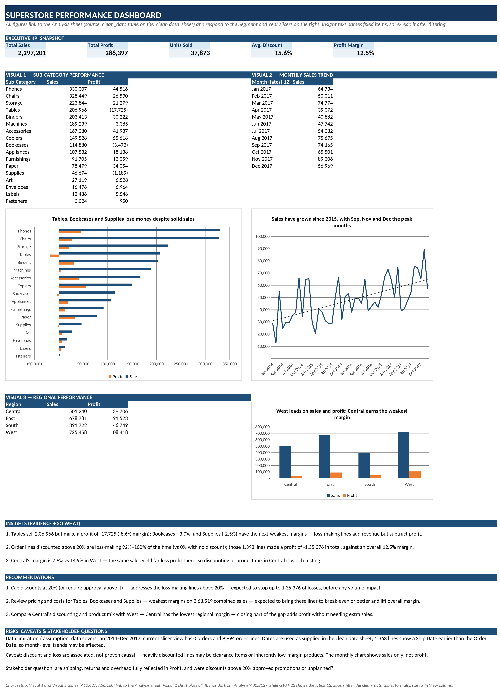
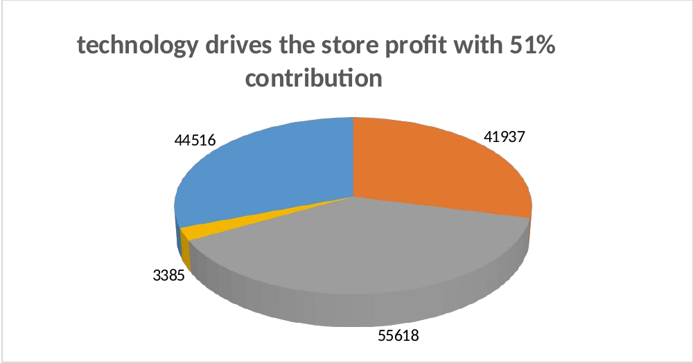

# Superstore Sales & Profitability Analysis

| | |
|---|---|
| **Project type** | Exploratory Data Analysis |
| **Tool** | Microsoft Excel (formulas, PivotTables, charts, correlation, dashboard) |
| **Data source** | Superstore retail transactions dataset |
| **Data size** | 9,994 order lines, 5,009 distinct orders |
| **Time period** | January 2014 – December 2017 |
| **Total sales / profit** | 2,297,201 / 286,397 (12.5% margin) |

## Business goals

Find the main revenue and profit drivers across customer segments, categories, sub-categories, regions and time, understand poorly performing products, test how discounting relates to profit, and recommend ways to improve performance. Full text: [Problem statement](docs/01_problem_statement.md).

## Workbook sheets

**Data sheets**
- **Raw_Data**: the original dataset, untouched.
- **clean data**: the cleaned table used for analysis, with a cleaning log. See [data cleaning and methodology](docs/03_data_cleaning_and_methodology.md).

**Analysis sheets (five analyses)**
1. **Segment vs sales** (`segment v sales`): share of sales and profit by customer segment.
2. **Category vs profit** (`tech pivot`): Technology profit, quantity and sales by sub-category.
3. **Region vs sales** (`region v sales`): profit share and order count by region.
4. **Sub-category vs sales and profit** (`avg sales v profit`): sales, average discount and profit or loss by sub-category and product.
5. **Discount vs profit** (`dis v profit`): profit and sales by discount band and category.

**Summary sheets**: `stats_summary` (mean, median, outliers, correlations), `Analysis` (formula-driven KPIs) and `Dashboard` (KPIs, charts, insights).

## Three key insights

1. **Technology drives profit.** It contributes 51% of total profit. Copiers earn 55,618 profit on 149,528 sales (37.2% margin), while Phones lead sales (330,007) at a 13.5% margin.

   

2. **High discounts lose money.** About 96.77% of order lines with discounts above 20% were unprofitable, against 6.08% at 20% or less. The overall Discount–Profit correlation is about −0.22 (weak linear, but the pattern by band is strong). This shows association, not proof of cause.
3. **Three sub-categories lose money.** Tables (−17,725, −8.6% margin), Bookcases (−3,473, −3.0%) and Supplies (−1,189, −2.5%). Machines sell 189,239 but earn only 3,385 profit.

More: [all key findings](docs/04_key_findings.md) and [summary business metrics](docs/05_summary_business_metrics.md).

## Recommendations

1. Review the discount strategy: add approval controls or per-product discount limits above 20%.
2. Investigate loss-making sub-categories (Tables, Bookcases, Supplies): pricing, discounts and product costs.
3. Improve low-margin performance in Machines, Chairs and Storage without sacrificing sales.
4. Grow profitable Technology products such as Copiers, and look into the lower profitability of Phones.
5. Investigate why the Central region has a lower margin (about 7.9%) than other regions.
6. Plan inventory and promotions around monthly sales patterns, while watching profit alongside revenue.

Full wording: [business recommendations](docs/06_business_recommendations.md).

## Documentation

1. [Problem statement](docs/01_problem_statement.md)
2. [Dataset overview](docs/02_dataset_overview.md)
3. [Data cleaning and methodology](docs/03_data_cleaning_and_methodology.md)
4. [Key findings](docs/04_key_findings.md)
5. [Summary business metrics](docs/05_summary_business_metrics.md)
6. [Business recommendations](docs/06_business_recommendations.md)
7. [Limitations and further analysis](docs/07_limitations_and_further_analysis.md)
