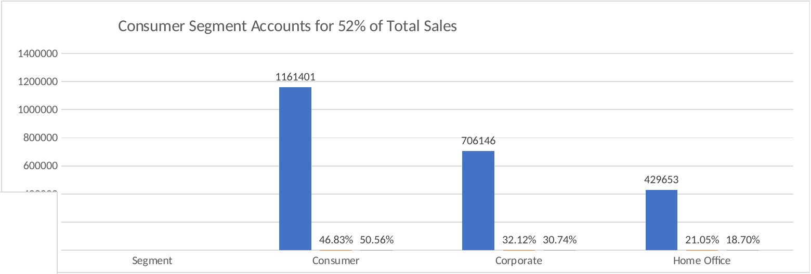
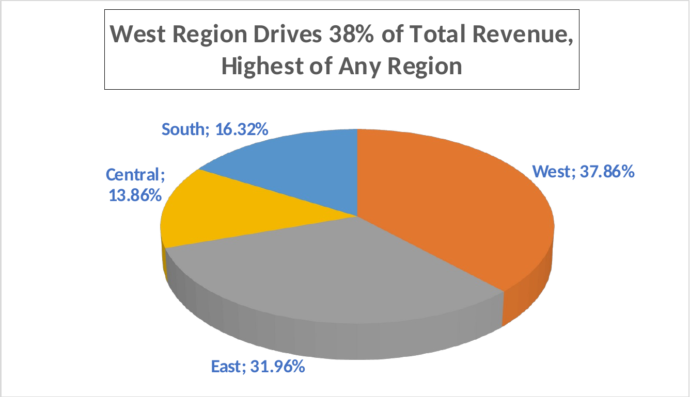
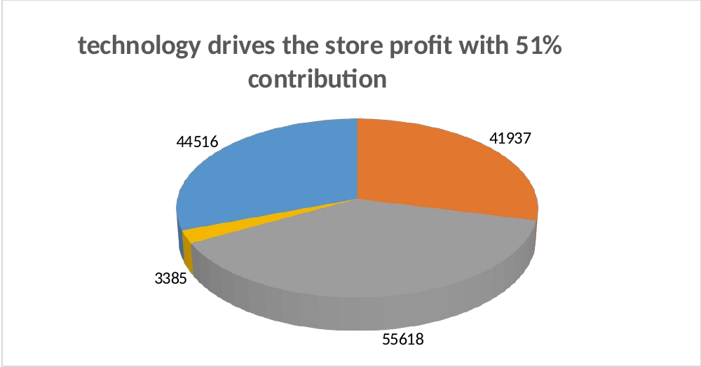

## 4. Key Findings

### A. Revenue and Customer Performance

**1. Customer Segment**

The Consumer segment contributes 52% of total store revenue, making it the largest revenue-generating customer segment.

**2. Regional Performance**

The West region leads regional performance with:
- Sales: 725,458
- Profit: 108,418
- Distinct Orders: 1,611
- Profit Margin: 14.9%

It contributes approximately 31.6% of total store revenue. The Central region has the lowest regional profit margin at approximately 7.9%, indicating an opportunity to investigate its profitability.

### B. Category and Sub-category Profitability

**3. Category Performance**

Technology contributes 51% of total store profit, making it the largest contributor to overall profitability.

**4. Technology Drill-down**

The Technology category shows a difference between revenue and profit leaders:

| Sub-category | Sales | Profit | Profit Margin |
|---|---:|---:|---:|
| Copiers | 149,528 | 55,618 | 37.2% |
| Phones | 330,007 | 44,516 | 13.5% |

Copiers generate the highest profit despite substantially lower sales, while Phones generate the highest sales. This highlights the importance of evaluating products using profitability as well as revenue.

**5. Loss-making Sub-categories**

Three sub-categories operate at negative profit margins:

| Sub-category | Sales | Profit | Profit Margin |
|---|---:|---:|---:|
| Tables | 206,966 | -17,725 | -8.6% |
| Bookcases | 114,880 | -3,473 | -3.0% |
| Supplies | 46,674 | -1,189 | -2.5% |

Tables record the largest absolute loss among these sub-categories.

**6. High-sales, Low-margin Sub-categories**

Some sub-categories generate substantial revenue but relatively low profit margins:

| Sub-category | Sales | Profit | Profit Margin |
|---|---:|---:|---:|
| Machines | 189,239 | 3,385 | 1.8% |
| Chairs | 328,449 | 26,590 | 8.1% |
| Storage | 223,844 | 21,279 | 9.5% |

Machines are particularly worth investigating because they generate 189,239 in sales but only 3,385 in profit.

**7. High-margin Sub-categories**

Labels, Paper and Copiers demonstrate strong profitability, with margins of 44.4%, 43.4% and 37.2%, respectively.

### C. Discount and Profitability Analysis

**8. Discounting and Profitability**

Approximately 96.77% of records/orders receiving discounts above 20% were unprofitable, compared with approximately 6.08% at discounts of 20% or less.

This indicates a strong association between higher discounts and unprofitability. However, the analysis does not establish that discounts alone caused the losses.

The overall correlation between Discount and Profit was approximately -0.20, indicating a weak negative linear relationship.

### D. Time-Based Performance

**9. Annual Sales and Profit Trend**

Sales increased significantly after 2015. The monthly data indicates the following annual performance:

- 2014: Sales of approximately 484,248.
- 2015: Sales of approximately 470,532.
- 2016: Sales of approximately 609,204.
- 2017: Sales of approximately 733,213.

The strongest annual growth occurred in 2016, followed by further growth in 2017. Annual profit also increased over the period.

**10. Monthly Performance**

- November 2017 recorded the highest monthly sales at approximately 118,448.
- December 2016 recorded the highest monthly profit at approximately 17,885.
- January 2015 recorded the largest monthly loss, approximately -3,281.

The difference between the highest-sales month and highest-profit month demonstrates that revenue growth does not necessarily translate into proportionate profit growth.

[Back to README](../README.md)
