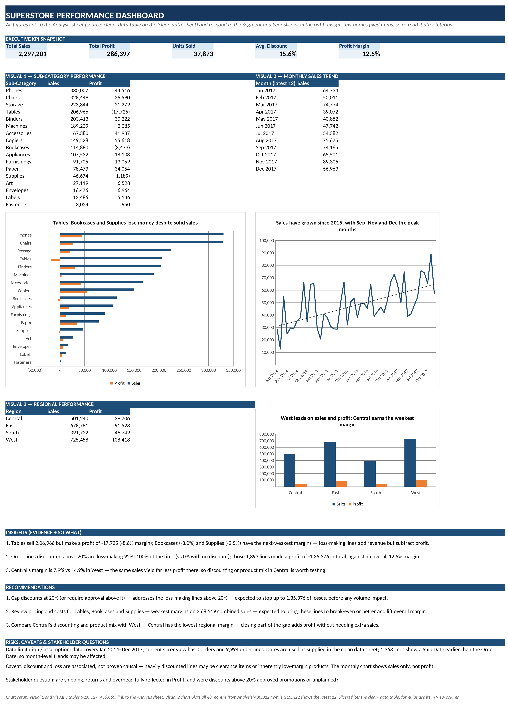

## 5. Summary Business Metrics

| Metric | Result |
|---|---:|
| Average Order Value | 458.61 |
| Overall Profit Margin | 12.5% |
| Loss-making Order Rate | 20.4% |
| Average Discount | 15.6% |
| Revenue per Unit | 60.66 |

**Metric definitions:**
- Average Order Value = Total Sales ÷ Distinct Order Count.
- Profit Margin = Total Profit ÷ Total Sales.
- Loss-making Order Rate = Orders with negative aggregated profit ÷ Total Distinct Orders.
- Average Discount = Average of the Discount column.
- Revenue per Unit = Total Sales ÷ Total Quantity.

[Back to README](../README.md)
